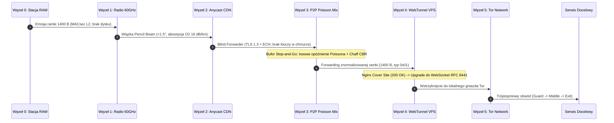

# PanzerNetworking 🛡️🚄
> **Advanced Zero-Trust Network Routing Reference Architecture & Interactive Digital Twin Simulation Framework**

[](https://github.com/Kvbi213/PanzerNetworking/actions)
[-00f0ff?style=flat&logo=vercel)](https://kvbi213.github.io/PanzerNetworking/)
[](docs/versions/v1.2.0.md)
[](LICENSE)
[](docs/architecture/MASTER_DOCUMENT.md)
[](package.json)

---

## 📌 1. Overview & Purpose

**PanzerNetworking** (`PANZER-NET`) to zaawansowana architektura referencyjna oraz interaktywne środowisko symulacyjne (**Digital Twin** 60 FPS) zaprojektowane w celu eliminacji współczesnych wektorów inwigilacji sieciowej, głębokiej inspekcji pakietów (**DPI**), pasywnej korelacji czasowej ruchu (**GPA Timing Correlation**) oraz śledzenia na poziomie przeglądarki (**Device & Browser Fingerprinting**).

Klasyczne rozwiązania ochrony prywatności (pojedyncze sieci VPN, czysty Tor, proxy SOCKS5) zawieszają zaufanie w jednym punkcie i ujawniają metadane na styku z lokalnym dostawcą internetu (ISP). PanzerNetworking rozbija transmisję na niezależne domeny fizyczne, chmurowe i kryptograficzne zgodnie z paradygmatem **Zero-Trust**: żaden pojedynczy węzeł w magistrali nie zna jednocześnie adresu źródłowego (kim jesteś), adresu docelowego (dokąd zmierzasz) oraz treści pakietu (co przesyłasz).

---

## 🌐 2. 6-Node Transit Pipeline Architecture

Pakiet opuszczający pamięć operacyjną stacji roboczej pokonuje 6-stopniowy, utwardzony rurociąg tranzytowy:

```text
[ WĘZEŁ 0: STACJA ROBOCZA ] ── (System RAM-only: Tails / Whonix + Moduł Kameleon)
       │
       ▼ [1. Warstwa Fizyczna (OSI L1/L2): Wąska wiązka 60 GHz V-Band | 802.11ad/ay]
[ WĘZEŁ 1: MOST RADIOWY PtP ] ──> [ ZEWNĘTRZNY PUNKT DOSTĘPOWY "A" (Dach/DropBox) ]
       │
       ▼ [2. Warstwa Zmyłkowa (OSI L4/L7): TLS 1.3 + ECH / Anycast Cloudflare]
[ WĘZEŁ 2: CHMURA ANYCAST CDN ] ── (Bezstanowy Edge Worker / Blind Forwarder)
       │
       ▼ [3. Warstwa Mieszająca (Mixnet): Bufor Poissona + Dummy Chaff (CBR)]
[ WĘZEŁ 3: WĘZEŁ P2P RELAY ] ── (Residential Mixnode / Stałe MTU 1400 B)
       │
       ▼ [4. Warstwa Wejściowa (Ingress): Tunelowanie HTTP/2 WebSocket (RFC 8441)]
[ WĘZEŁ 4: WEBTUNNEL VPS ] ── (Offshore VPS No-KYC za kamuflażem Nginx/Caddy)
       │
       ▼ [5. Warstwa Cebulowa (Onion Routing): 3-Hop Circuit + Stream Isolation]
[ WĘZEŁ 5: SIEĆ TOR / MIXNET ] ── [ Guard ] ──> [ Middle ] ──> [ Exit ] ──> [ CEL ]
```



---

## 🔐 3. Wielowarstwowa Kaskada Kryptograficzna (Model Matrioszki)

Architektura łączy **hybrydyzację postkwantową (Post-Quantum KEM)** z podwójną kaskadą symetryczną o całkowicie odmiennych strukturach algebraicznych (**SPN + ARX**), zapewniając zasadę *Defense-in-Depth*:

```text
┌──────────────────────────────────────────────────────────────────────────────┐
│ POWŁOKA 1: KOPERTA TRANSPORTOWA & STEGANOGRAFIA (DPI STEGO ENVELOPE)         │
│ Nagłówek TLS 1.3 (Application Data 0x17) + ECH + Padding do 1400 B           │
│ ┌──────────────────────────────────────────────────────────────────────────┐ │
│ │ POWŁOKA 2: INKAPSULACJA POSTKWANTOWA (HYBRID KEM: X25519 + ML-KEM-1024)  │ │
│ │ Uzgadnianie kluczy odporne na algorytm Shora (FIPS 203) i wektor SNDL     │ │
│ │ ┌──────────────────────────────────────────────────────────────────────┐ │ │
│ │ │ POWŁOKA 3: SZYFR STRUMIENIOWY XCHACHA20-POLY1305 (256-BIT, ARX)      │ │ │
│ │ │ 192-bitowy rozszerzony Nonce, odporność na ataki cache-timing        │ │ │
│ │ │ ┌──────────────────────────────────────────────────────────────────┐ │ │ │
│ │ │ │ POWŁOKA 4: SZYFR BLOKOWY AES-256-GCM (256-BIT, SPN)              │ │ │ │
│ │ │ │ 14 rund Rijndaela, autentykacja w ciele Galois GF(2^128)         │ │ │ │
│ │ │ │ ┌──────────────────────────────────────────────────────────────┐ │ │ │ │
│ │ │ │ │ POWŁOKA 5: POTRÓJNY SZYFR CEBULOWY TOR + ŁADUNEK (PAYLOAD)   │ │ │ │ │
│ │ │ │ │ Komórki Tor (514 B) + Docelowy strumień end-to-end TLS       │ │ │ │ │
│ │ │ │ └──────────────────────────────────────────────────────────────┘ │ │ │ │
│ │ │ └──────────────────────────────────────────────────────────────────┘ │ │ │
│ │ └──────────────────────────────────────────────────────────────────────┘ │ │
│ └──────────────────────────────────────────────────────────────────────────┘ │
└──────────────────────────────────────────────────────────────────────────────┘
```

* **Derywacja kluczy sesyjnych (HKDF-SHA512):**
  $$K_{\text{master}} = \text{HKDF-Extract}\left(\text{Salt}, \; \text{SS}_{\text{X25519}} \parallel \text{SS}_{\text{ML-KEM-1024}}\right)$$
* **Automatyczny Ratcheting PFS:** Co **60 sekund** (lub $10^6$ przesłanych pakietów) następuje odświeżenie kluczy w pamięci RAM.

---

## 📦 4. Znormalizowana Ramka MTU 1400 B (RFC 8441 Steganography)

Aby uniemożliwić systemom DPI identyfikację protokołów po sygnaturach uścisku dłoni czy rozmiarze pakietu, każdy rekord tranzytowy posiada stałą długość **1400 bajtów**:

```text
 0                   1                   2                   3
 0 1 2 3 4 5 6 7 8 9 0 1 2 3 4 5 6 7 8 9 0 1 2 3 4 5 6 7 8 9 0 1
+-+-+-+-+-+-+-+-+-+-+-+-+-+-+-+-+-+-+-+-+-+-+-+-+-+-+-+-+-+-+-+-+
| Content Type  |         TLS Version           |    Length     |  <-- Nagłówek TLS 1.3
|    (0x17)     |           (0x0303)            |   (1395 B)    |      (5 bajtów - Jawny)
+-+-+-+-+-+-+-+-+-+-+-+-+-+-+-+-+-+-+-+-+-+-+-+-+-+-+-+-+-+-+-+-+
|                                                               |
+                  XChaCha20 Extended Nonce                     +  <-- Wektor IV (24 B)
|                         (192 bity)                            |
+-+-+-+-+-+-+-+-+-+-+-+-+-+-+-+-+-+-+-+-+-+-+-+-+-+-+-+-+-+-+-+-+
|  Packet Type  |         Payload Length        |   Reserved    |  <-- Nagłówek wewnętrzny
| (0x01 / 0xFF) |           (2 bajty)           |   (1 bajt)    |      (0x01 = Dane, 0xFF = Chaff)
+-+-+-+-+-+-+-+-+-+-+-+-+-+-+-+-+-+-+-+-+-+-+-+-+-+-+-+-+-+-+-+-+
|                                                               |
~                   ZASZYFROWANY ŁADUNEK AES-GCM                ~  <-- Komórki Tor + Payload
|                   (Od 0 do 1322 bajtów danych)                |
+-+-+-+-+-+-+-+-+-+-+-+-+-+-+-+-+-+-+-+-+-+-+-+-+-+-+-+-+-+-+-+-+
|                                                               |
~             LOSOWY PADDING WYRÓWNUJĄCY (0x00..0xFF)           ~  <-- Dopełnienie do 1400 B
|                                                               |
+-+-+-+-+-+-+-+-+-+-+-+-+-+-+-+-+-+-+-+-+-+-+-+-+-+-+-+-+-+-+-+-+
|                   AES-256-GCM Auth Tag (16 B)                 |  <-- Integralność Węzła 4
+-+-+-+-+-+-+-+-+-+-+-+-+-+-+-+-+-+-+-+-+-+-+-+-+-+-+-+-+-+-+-+-+
|                    Poly1305 Auth Tag (16 B)                   |  <-- Integralność Węzła 3
+-+-+-+-+-+-+-+-+-+-+-+-+-+-+-+-+-+-+-+-+-+-+-+-+-+-+-+-+-+-+-+-+
```

* **Entropia Shannona:** $H(X) = -\sum P(x_i) \log_2 P(x_i) \approx 7.9994\text{ b/B}$ (potwierdzona testami NIST SP 800-22).
* **Nierozróżnialność:** Pakiet danych (`0x01`) i pakiet szumowy *Dummy Chaff* (`0xFF`) są kryptograficznie nieodróżnialne dla zewnętrznego obserwatora.

---

## 🦎 5. Moduł Aplikacyjny Kameleon (Anti-Fingerprinting)

Działa na Węźle 0, zapewniając ochronę przed systemami antybotowymi i identyfikacją behawioralną:

| Tryb | Profil Sieci & Przeglądarki | Widok Serwera Docelowego |
| :--- | :--- | :--- |
| **GHOST / STEALTH** | Czysty IP (VPS/Exit Node) + Spoofing Win11 / Chrome 128 | Zwykły użytkownik domowy, brak CAPTCHA |
| **BURNER / ISOLATE** | Pełna trasa 6 węzłów + Tor Browser Safest (JS disabled) | Zunifikowany Tor profil, RAM wipe po sesji |
| **MULTI-PERSONA** | Każda karta w osobnym obwodzie Tor z unikalnym ziarnem Canvas | 3 różne komputery w 3 różnych krajach |

---

## ⚡ 6. Interaktywny Cyfrowy Bliźniak (Digital Twin Web Platform)

Aplikacja zrealizowana w oparciu o wytyczne **Apple Design System** (płynna fizyka sprężynowa, bezpośrednia manipulacja 1:1, materiały translucentne, natychmiastowa responsywność):

1. **Moduł 1: Interaktywna Trasa Pakietu & Wireshark Live Inspector (`#tab-route`):** Krokowe przejście przez 6 węzłów, live hex/ASCII dump ramki 1400 B i obliczanie entropii $H(X)$.
2. **Moduł 2: Symulator Fizyki Ruchu 60 FPS (`#tab-sim`):** Silnik cząsteczkowy HTML5 Canvas 2D Retina/High-DPI z buforem Poissona w Węźle 3 i ruchem Dummy Chaff.
3. **Moduł 3: Dekonstruktor Kaskady Matrioszki (`#tab-matrioszka`):** Interaktywny model SVG 5 powłok z podglądem algebry SPN, ARX i krat M-LWE.
4. **Moduł 4: Macierz Wektorów Ataku GPA-R (`#tab-matrix`):** 4 scenariusze stresowe z oceną bayesowską prawdopodobieństwa sukcesu adwersarza.
5. **Moduł 5: Panel Audytowy i Obrona Architektury (`#tab-defense`):** Akordeon inżynieryjny Q&A, bilans opóźnień RTT (~231 ms) i zestawienie BOM.

---

## 📊 7. Macierz Odporności Wektorowej (Widok Adwersarza)

| # | Obserwator / Adwersarz | Co widzi w logach? | Czego NIE JEST w stanie ustalić? | Wektor mitygacji w PanzerNet |
| :-: | :--- | :--- | :--- | :--- |
| **1** | **Domowy ISP Operatora** | Stan linii: IDLE (0 B) | Obecności operatora i transmisji | Most radiowy 60 GHz (Węzeł 1) |
| **2** | **Skaner radiowy (Wardriving)** | Szum tła 2.4 / 5 GHz | Istnienia wąskiej wiązki 60 GHz | Pencil Beam <1.5° + tłumienie $O_2$ |
| **3** | **ISP Punktu DropBox A** | TLS 1.3 (1400 B) do Cloudflare | Lokalizacji Węzła 0 i subdomeny | ECH + Anycast CDN (Węzeł 2) |
| **4** | **System DPI / Cenzor** | Legalny ruch HTTPS/WebSocket | Sygnatur OpenVPN/WireGuard/Tor | Koperta steganograficzna (Węzeł 4) |
| **5** | **Globalny Obserwator (IXP)** | Strumień stałego CBR | Korelacji wejście-wyjście ($\Delta t$) | Bufor Poissona + Dummy Chaff (W3) |
| **6** | **Tor Guard Node** | Połączenie z VPS Węzła 4 | IP Węzła 3, Punktu A, Węzła 0 | Wielowarstwowe odcięcie tranzytowe |
| **7** | **Serwis Docelowy** | Profil zwykłego PC domowego | Systemu Tails i fizycznej tożsamości | Moduł Kameleon (Spoofing) |

---

## 🛠️ 8. Szybki Start (Instalacja i Uruchomienie)

### Wymagania wstępne:
* Node.js v20+ lub v22+
* npm v10+

### Uruchomienie deweloperskie:
```bash
# Klonowanie repozytorium
git clone https://github.com/Kvbi213/PanzerNetworking.git
cd PanzerNetworking

# Instalacja zależności
npm install

# Uruchomienie symulatora Digital Twin (60 FPS)
npm run dev
```
Aplikacja uruchomi się lokalnie pod adresem: `http://localhost:3000/`.

### Budowanie produkcyjne:
```bash
# Weryfikacja typów TypeScript i kompilacja bundla Vite
npm run build
```
Zoptymalizowane pliki statyczne zostaną wygenerowane w katalogu `dist/`.

---

## 📁 9. Dokumentacja i Zasoby

* 📄 **[MASTER_DOCUMENT.md](docs/architecture/MASTER_DOCUMENT.md)** — Nadrzędna specyfikacja inżynieryjna L1–L7, Threat Model GPA-R i dowody matematyczne.
* 🏛️ **[ARCHITECTURE.md](ARCHITECTURE.md)** — Mapa komponentów, rejestr długu technicznego i powiązania modułów.
* 📜 **[HISTORY.md](HISTORY.md)** — Dziennik zmian i rewizji w modelu SemVer append-only.
* 💰 **[BOM_CALCULATION.md](data/finanse/BOM_CALCULATION.md)** — Szczegółowy kosztorys wdrożeniowy (Warianty A, B, C).
* 🔬 **[NIST_SP800_22_RESULTS.json](data/scans/NIST_SP800_22_RESULTS.json)** — Wyniki laboratoryjnych testów losowości i entropii Shannona.
* 🛡️ **[ZERO_LEAK_AUDIT_REPORT.md](data/reports/ZERO_LEAK_AUDIT_REPORT.md)** — Raport 24h pasywnego audytu szczelności Hardware TAP.
* ⏱️ **[KS_TIMING_CORRELATION_TEST.md](data/reports/KS_TIMING_CORRELATION_TEST.md)** — Wyniki testu Kołmogorowa-Smirnowa dla bufora Poissona.

---

## ⚖️ Licencja & Zastrzeżenie Badawcze

Projekt udostępniany na licencji **MIT License** z klauzulą badawczo-edukacyjną. Zobacz plik [LICENSE](LICENSE) po szczegóły.
*PanzerNetworking jest architekturą referencyjną przeznaczoną do celów badawczych, edukacyjnych i modelowania systemów bezpieczeństwa Zero-Trust.*
